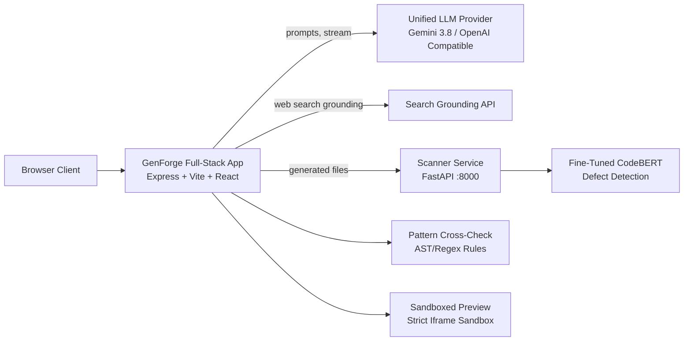

<div align="center">
  
  <h1>GenForge</h1>
  <p><strong>Describe an app. Review the code before you trust it.</strong></p>
  <p>An AI app builder and question-answering studio with a built-in code security reviewer trained by the author.</p>

  <p>
    
    
    
    
    
  </p>
</div>

---

## Why GenForge Exists

AI tools can write small web applications from a single prompt, but generated code is rarely vetted before people run it. GenForge closes that gap: every generated file is reviewed by a fine-tuned CodeBERT model and a deterministic pattern cross-check, presenting findings as **two separate signals** before you deploy.

> **Positioning:** *"A second opinion, not a certificate of safety."*

---

## Core Capabilities

| Mode | What it does |
|---|---|
| **Build Mode** | Describe an app in plain language and get real generated code, live sandboxed preview, and console with AI Auto-Fix. Follow-up prompts edit the existing codebase. |
| **Ask Mode** | High-precision question-answering chat with streaming answers, optional web search grounding, and cited sources. |
| **Scan Mode** | Every generated file is reviewed by a fine-tuned CodeBERT model and a pattern matcher, shown as two decoupled signals with line-level navigation. |
| **Branding Customizer** | Live modification of theme tokens (color palettes, font pairings, logo upload) in the preview without regenerating code. |
| **Template Gallery** | 8 working production starters (SaaS, portfolio, dashboard, pomodoro, shop, notes, blog) plus 1 intentional vulnerability demo playground. |
| **Studio Tools** | Run settings (model, temperature, system instructions), version checkpoints with restore, zip export, and quota control. |

---

## Architecture



---

## Scanner Methodology & Metrics

The neural scanner is based on `microsoft/codebert-base`, fine-tuned for binary defect classification on the CodeXGLUE Devign dataset (C functions).

### Held-Out Test Results (2,732 Test Functions)
*Metrics loaded directly from `metrics.json`:*

| Metric | Score | Formula |
|---|---|---|
| **Precision** | **64.8%** | `TP / (TP + FP)` |
| **Recall** | **68.3%** | `TP / (TP + FN)` |
| **F1 Score** | **66.5%** | `2 * (P * R) / (P + R)` |
| **ROC-AUC** | **0.732** | Area under ROC Curve |
| **Accuracy** | **65.2%** | `(TP + TN) / Total` |

### Confusion Matrix
- **True Positives (TP):** 852 (Defects correctly flagged)
- **False Positives (FP):** 462 (Benign code flagged)
- **True Negatives (TN):** 928 (Benign code verified)
- **False Negatives (FN):** 490 (Subtle defects missed)

---

## Limitations

Being clear about what this system cannot do is essential:
1. **Language Mismatch:** The CodeBERT checkpoint was fine-tuned on C code. Inferences on JavaScript, TypeScript, and Python rely on cross-lingual transformer representation and are not formally benchmarked.
2. **Dual-Direction Error Margin:** The model produces false positives and false negatives.
3. **Not a Formal Certification:** GenForge provides an automated second opinion, not a legal security audit or penetration testing guarantee.
4. **AI Hallucinations:** Large language models can make mistakes. Critical advice in medical, legal, or financial realms requires licensed professionals.

---

## Quickstart

### 1. Clone & Install
```bash
git clone https://github.com/Madiha-Maha/genforge.git
cd genforge
npm install
```

### 2. Configure Environment
```bash
cp .env.example .env
# Configure GEMINI_API_KEY (or LLM_BASE_URL + LLM_API_KEY)
```

### 3. Start Scanner Service (Optional / Python)
```bash
cd scanner-service
pip install -r requirements.txt
uvicorn main:app --port 8000
```

### 4. Start GenForge Web App
```bash
# In the project root:
npm run dev
```
Open [http://localhost:3000](http://localhost:3000) in your browser.

---

## Evaluation Suite & Smoke Testing

Run the automated smoke test:
```bash
npx tsx scripts/smoke-test.ts
```

Run the benchmark evaluation (30 Ask questions + 10 Build benchmarks):
```bash
npx tsx -e 'import("./scripts/evaluation-suite.ts").then(m => m.runEvaluation())'
```

---

## Author & Attribution

Built with care by **Madiha Maha**, B.Tech Computer Science and Engineering student.
GitHub: [@Madiha-Maha](https://github.com/Madiha-Maha)

---

## License

MIT License. Check licenses of underlying base models (`microsoft/codebert-base`) and dataset (`CodeXGLUE`) before commercial use.
